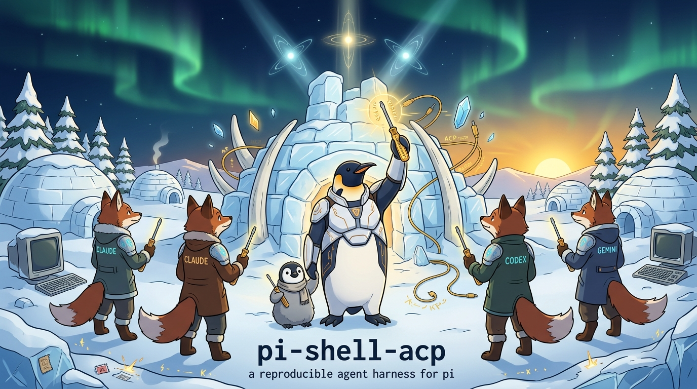
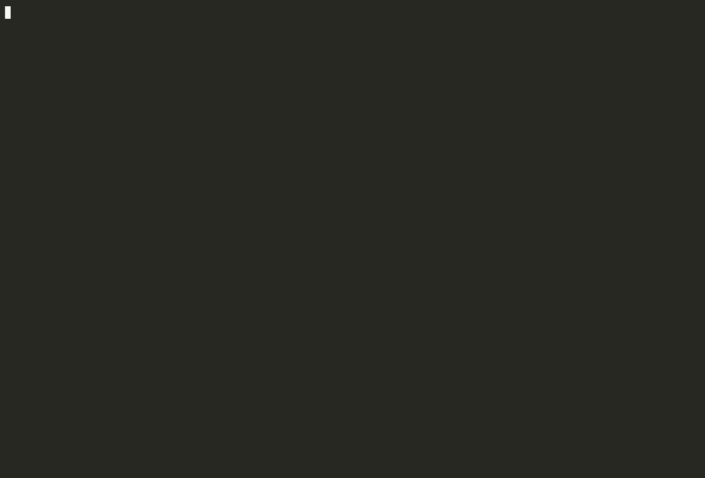

# entwurf

`entwurf` connects independent agent harnesses as visible siblings. Open a fresh sibling, or reopen
or message an existing one by its **garden id**. Every harness keeps its own runtime,
authentication, tools and transcript; Entwurf adds identity, delivery, receipts and named
lifecycle verbs.



**Pi ↔ native Claude Code inside the [Herdr workbench](#herdr-workbench).**
A recorded source-checkout demo: callback → task → native Bash → reply.
[Source recipe and original provenance](demo/README.md#whole-herdr-pi--native-claude-code-138)
(the recipe creates a new take; the original private capture is not shipped).



[](https://www.npmjs.com/package/@junghanacs/entwurf) · maintained by [junghanacs.com](https://junghanacs.com/)

## Why

- **Siblings, not workers.** A sibling is a visible session with its own runtime boundary, not a
  disposable worker or a subagent of a new central harness. You and the native harnesses keep
  steering; branches, worktrees, file isolation and internal delegation stay their concern.
- **Native harnesses stay native.** Claude Code keeps its hooks and tools, Codex its own threads and
  delegation, pi its extensions. Entwurf reconstructs no prompt, hydrates no transcript and mediates
  no credential.
- **One address.** A garden id names a record-backed citizen. A pane, socket, native session id or
  model is a carrier or an observation, never a second address.
- **The same verbs on both screens.** In an ordinary tmux session or inside a Herdr workspace, a
  sibling opens and reopens beside you through the same tools. The rail follows where the caller
  runs, with no fallback from one to the other.

[Short answers: FAQ](./FAQ.md).

## The four verbs

| Verb | Tool | What it does | Harnesses |
|---|---|---|---|
| **Open** | `entwurf_fresh_call` | Opens a new visible sibling beside the caller — a new Herdr tab, or a tmux window — and hands it a first task. The sibling's own callback supplies its garden id | tmux: pi, pi-durable, Claude Code, Copilot, OMP, Codex. Herdr: pi, pi-durable, Claude Code |
| **Reopen** | `entwurf_resume_call` | Reopens a dormant sibling under the same garden id, its record selecting the native session. Submits no prompt | pi, pi-durable, Claude Code |
| **Message** | `entwurf_v2` | Delivers to an existing sibling over its own rail. Starts no process | pi, pi-durable, Claude Code, Copilot, OMP, Codex |
| **Retire** | `entwurf_retire_call` | One guarded attempt on one sibling the human operator explicitly named. The record stays for a later same-id return | pi, Claude Code |

Every verb returns a receipt, not the sibling's turn result. Capabilities differ by rail, so a
shipped citizen is not a promise of every lifecycle operation; [DELIVERY](./DELIVERY.md) owns each
rail's admission. Antigravity is a legacy citizen: it registers an existing conversation, Entwurf
never launches one, and its native push is paused (#152).

Capabilities here describe this source and ref; an installed release can differ — see its
[release notes](https://github.com/junghan0611/entwurf/releases) and
[package-specific setup](./docs/setup-clean-host.md#requirements).

## Install

Bring your own harnesses, subscriptions and logins. Entwurf installs its own bytes and composes the
harnesses it finds; it needs Node 24 or newer, Python 3 for `setup`, and whichever harnesses you
use, already installed and signed in.

### Direct — ordinary shell or tmux

```bash
npm install -g @junghanacs/entwurf
entwurf setup /path/to/your-project
entwurf check-bridge
```

`setup` composes each harness it finds and reports PASS / SKIP / FAIL. An absent harness is an
explicit SKIP; a detected incomplete or below-floor integration is a named FAIL with a nonzero exit,
not a false green. `check-bridge` proves the installed MCP bytes boot and list their tools without
backend auth; it does **not** certify a model turn or a receive rail.

[Clean-host setup](./docs/setup-clean-host.md) owns the supported harness versions, installing a
chosen package version, project-local and source installs, the per-harness steps (Codex needs
[your own trust decision and app-server](./docs/setup-clean-host.md#three-operator-decisions-before-fresh)),
doctors, upgrade, repair and uninstall. Plain MCP registration alone does not make a garden citizen.
Linux is the certified harness-rail axis; [BASELINE](./BASELINE.md#release-host-baseline) owns the
macOS, WSL2 and native-Windows evidence split, and an npm package without an `os` restriction is not
an all-platform certification.

### Native durable (pi-durable)

```bash
entwurf pi-durable --provider <provider> --model <model-id> --width task-wide
entwurf pi-durable --continue
entwurf pi-durable --resume
entwurf pi-durable --session <native id>
```

The package supplies Entwurf's thin app/TUI carrier and the exact pi SDK set it declares; the launch
verifies both and refuses incomplete, drifted or mixed supply by name. No separate runtime checkout,
patch, build or ordinary Pi CLI is needed. The contact adds garden identity and two-way mailbox
communication; execution, models, auth, queues, storage and recovery stay the upstream SDK's
([Hard Rule 17](./AGENTS.md#hard-rules): **supply the missing surface; do not become the harness**).
Selectors, native modules and refusals:
[setup §2b](./docs/setup-clean-host.md#2b-optional-native-durable-pi-durable).

### Herdr workbench

```bash
herdr plugin install junghan0611/entwurf/plugins/herdr --yes
```

This separate path activates Herdr-integrated **pi and Claude Code** with its own locked runtime
and an observation pane. By default it puts no Entwurf bins on PATH; a runtime that carries
`herdr-plugin-expose-operator` makes exactly one `entwurf` link, and only when you ask for it.
An Entwurf release does not re-pin that runtime by itself; the
[Herdr guide](./plugins/herdr/README.md#from-a-raw-linux-box-in-nine-steps) says which runtime each
ref installs and owns install, use, evidence and removal. The plugin owns neither delivery nor the
Herdr launch rail.

## First steps

Start a citizen in your project:

```bash
cd /path/to/your-project
entwurf pi
```

`entwurf pi` execs your own pi with the control flag (`pi --entwurf-control` is equivalent once the
package is registered); the record mints the garden id, so do not inject a session id.
`entwurf claude [args…]` execs the `claude` on your PATH with its arguments unchanged; a Claude Code
session is a citizen through the hooks `entwurf install-meta-bridge` installed
([setup §3](./docs/setup-clean-host.md#3-optional-claude-code-native-citizen)), however it started.
`entwurf pi-durable` is the durable contact above. `entwurf --help` is the quick overview of the
other entries and `entwurf help all` the full catalog; `entwurf help team` and
`entwurf help remote-pair` are the two guides.

In that harness session, ask the agent to:

1. Call `entwurf_self` to confirm its identity.
2. Call `entwurf_peers` to see existing siblings and their liveness facts.
3. Pick a live garden id and call `entwurf_v2` with a message, for example:

```json
{
  "target": "<garden-id from entwurf_peers>",
  "intent": "fire-and-forget",
  "message": "Hello from a sibling.",
  "wants_reply": true
}
```

These are MCP tools inside a session, not shell commands; pi reaches them as
`mcp__entwurf_bridge__<verb>` through its built-in MCP. A running host offers what its
already-loaded bridge listed:
[applying new source to a running host](./docs/setup-clean-host.md#applying-new-source-to-a-running-host).

## How delivery works

### `entwurf_v2` — canonical dispatch verb

```text
pi / pi-durable / Claude Code / Copilot / OMP / Antigravity / Codex
  → record-backed garden id
    → entwurf_v2
      → control-socket | self-fetch mailbox | native-push
```

**Delivery starts no process.** The record is the sole address authority, and liveness is read at
dispatch time: a live pi receives over its control address, an armed self-fetch citizen through its
mailbox, a probe-alive native-push citizen in its own conversation. Anything else is refused, never
launched into. The receipt is the receiver's acceptance boundary, a durable mailbox file or an
injection — never the sibling's turn result; `wants_reply` is etiquette, not waiting.
[DELIVERY](./DELIVERY.md#control-socket-acceptance-boundaries-120) owns what each boundary means.

**Lifecycle verbs keep their own receipts.** Open returns a launch receipt, not an address; reopen
separates its launch from its observation; retire reports action, record and lock separately.
**Retirement is never autonomous:** it needs the human operator's explicit target and action, and no
role, caller identity or tool annotation grants it
([DELIVERY](./DELIVERY.md#candidate-lifecycle-commands-are-not-delivery-boundaries-147)).

**Lifecycle launch is separate from `entwurf_v2` delivery.** Open and reopen place a sibling in the
caller's Herdr workspace or tmux session; `placement.tmuxSession` names another existing tmux session and is refused inside Herdr.
Missing or ambiguous context refuses with no fallback:
[tmux launch](./docs/mux-launch-rail.md) · [Herdr launch](./docs/herdr-launch-rail.md).

### Remote siblings and team bookmarks

**Remote pairs** are opt-in. Each host declares the pair in its own file, and `entwurf_v2` to the
remote garden id makes one SSH attempt over your own account, checked and dispatched by the host that
holds the record — no discovery, wake or retry. `entwurf help remote-pair`, the steps in
[setup §2c](./docs/setup-clean-host.md#2c-optional-remote-pair-between-two-hosts-107), the
[principles](./docs/remote-sibling-principles.md) and the
[contract](./DELIVERY.md#remote-pairs-107-149-declared-pairs-across-hosts).

**Team bookmarks:** [`team.json.example`](./team.json.example) is a person's note of the siblings one
project works with, copied to an ignored `team.json`. Entwurf never loads it as configuration for
identity, routes, roles, permissions or lifecycle. `entwurf help team`.

## Concepts

**Entwurf** (기투, projection-of-self) connects independent visible siblings; a **garden id** names
a record-backed citizen, not its pane or native transcript. The package holds the v2 core, the
native-harness bridges, a pi adapter and an ACP plugin. ACP is one ingress, not the boundary; pi is
one adapter, not the center. Claude and Cortex Code are ACP backends; Codex and Antigravity stay
native so they keep their own tools and work context. The pi adapter registers the compiled bridge
with Pi's built-in MCP after record birth, while pi's own receive stays its record-addressed control
address. [FAQ](./FAQ.md) explains ACP, MCP and context carriers.

Product guidance and CLI help each have one editable source: [ENTWURF.json](./ENTWURF.json) for
the MCP tool descriptions and the hints extracted there, [ENTWURF-CLI.json](./ENTWURF-CLI.json) for
`entwurf --help`. [AGENTS](./AGENTS.md#architecture) lists exactly what each carries.

## Operation guides

- [Settings and backend keys](./docs/setup-clean-host.md#settings-reference-and-backend-specific-keys)
- [External MCP registration](./docs/setup-clean-host.md#stable-bins-and-external-mcp-hosts) · [manual wiring](./docs/external-mcp-host.md)
- [Custom skills](./docs/setup-clean-host.md#custom-skills)
- [Context carriers](./docs/setup-clean-host.md#context-carriers)
- [Reuse and compaction](./docs/setup-clean-host.md#session-reuse-and-compaction) — native harness-owned; no transcript hydration

## What this repo owns, and does not

Owns: garden identity, live-fact dispatch and receipts, native bridge integrations,
visible lifecycle launch seams, the pi adapter and isolated ACP plugin lifecycle.
Does not: a second harness, memory DB, prompt reconstruction, transcript hydration,
credential mediation, subscription bypass, pane-typing delivery or hidden orchestration.
[AGENTS](./AGENTS.md) owns these invariants and exact capability boundaries.

## Verification surfaces

- [VERIFY](./VERIFY.md): evidence strength, deterministic/package gates and LIVE release protocol.
- [BASELINE](./BASELINE.md): operator-driven observations and dated host receipts.
- [DELIVERY](./DELIVERY.md): per-harness async receive capabilities, boundaries and limits.

Installation, a doctor, a fixture and an exact release candidate prove different things;
none is interchangeable with the others or an all-host/long-haul guarantee.
[Releases](https://github.com/junghan0611/entwurf/releases) carry each cut's notes and acceptance
receipts; [CHANGELOG](./CHANGELOG.md) records source history.

## References

- [FAQ](./FAQ.md) · [Clean-host setup](./docs/setup-clean-host.md) · [Release record](./CHANGELOG.md)
- [Current ordering](https://github.com/junghan0611/entwurf/blob/main/NEXT.md)
- [Adding a harness](https://github.com/junghan0611/entwurf/blob/main/docs/adding-a-harness.md)
- [ACP backend contract](./docs/acp-backend-rail.md)
- [xenodium/agent-shell](https://github.com/xenodium/agent-shell) — Emacs ACP client, `resume > load > new` origin
- [claude-agent-acp](https://github.com/agentclientprotocol/claude-agent-acp) — canonical Claude ACP server
- [agent-config](https://github.com/junghan0611/agent-config) — real consumer

## License

MIT
