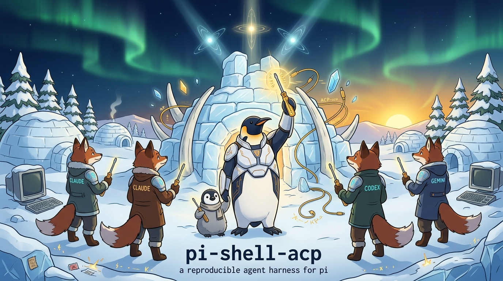
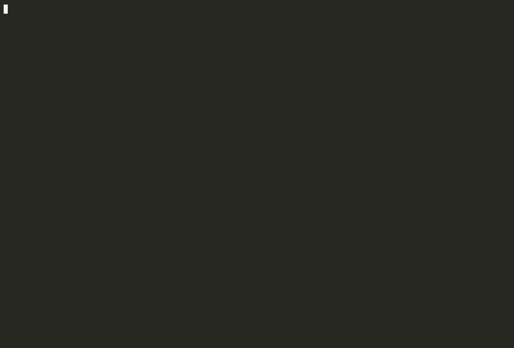

# entwurf

`entwurf` connects independent agent harnesses as visible siblings: open a new session,
reopen a supported dormant sibling in tmux, or reach an existing sibling by **garden id**. Fresh
sessions open in the caller's Herdr workspace or tmux session by default; explicit tmux
placement can name another existing session. Each harness keeps its own runtime,
authentication, tools and transcript.



**Pi ↔ native Claude Code inside the [Herdr workbench](#herdr-workbench).**
A recorded source-checkout demo: callback → task → native Bash → reply.
[Source recipe and original provenance](demo/README.md#whole-herdr-pi--native-claude-code-138)
(the recipe creates a new take; the original private capture is not shipped).



[](https://www.npmjs.com/package/@junghanacs/entwurf) · maintained by [junghanacs.com](https://junghanacs.com/)

A sibling is a visible session with its own runtime boundary, not a disposable
worker or a subagent of a new central harness. Entwurf supplies identity, delivery,
receipts and named lifecycle verbs; the operator and native harnesses keep steering.
Git branches, worktrees, file isolation and internal delegation remain their concern.
[Short answers: FAQ](./FAQ.md).

| Verb | Tool | Where it lands | Harnesses |
|---|---|---|---|
| **Open** a new sibling | `entwurf_fresh_call` | Herdr: a new unfocused tab in the caller's workspace. tmux: a new window in the caller's session, or an existing session named by `placement.tmuxSession`; without an explicit tmux placement, a Codex caller opens beside its own TUI pane | Herdr: pi, Claude Code. tmux: pi, pi-durable, Claude Code, Copilot, OMP, Codex |
| **Reopen** a dormant sibling | `entwurf_resume_call` | A visible tmux window under the same garden id, with its record selecting the native session (Pi: identity-checked recorded transcript supplies launch metadata; Claude Code: `claude --resume <session id>` at the record cwd); the verb submits no prompt | pi, Claude Code |
| **Retire** one sibling the human operator explicitly requested | `entwurf_retire_call` | One guarded attempt on that target: a Pi shutdown request or Claude Code fd-pinned process termination. Refused/unknown outcomes remain possible; the record stays for guarded same-id return. Not a grant, a roster cleanup or an automatic retry | pi, Claude Code |
| **Message** an existing sibling | `entwurf_v2` | Its own rail: control socket, self-fetch mailbox or native push; delivery starts no process | pi, pi-durable, Claude Code, Copilot, OMP, Codex (Antigravity native push is paused, #152) |

Antigravity is a legacy citizen: an existing conversation registers itself, and Entwurf never
launches one. Its native push is paused (#152): on the measured external path the agy language server
refused Entwurf's calls for a missing CSRF token, so a message to it is refused as `native-push-paused`. A launch receipt is neither the new sibling's address nor proof that it
processed its task; the sibling's own callback envelope supplies its garden id.

The package holds the v2 core, native-harness bridges, a pi adapter and an ACP
plugin. ACP is one ingress, not the boundary; pi is one adapter, not the center.
Claude and Cortex Code are ACP backends. Codex and Antigravity stay native so they
retain their own tools and work context. Capabilities differ by rail: a shipped
citizen is not a promise of every lifecycle operation.

[Releases](https://github.com/junghan0611/entwurf/releases) contain each cut's notes and acceptance
receipts; [CHANGELOG](./CHANGELOG.md) records source history.

## Install

**Choose by where you work. Bring your own harnesses, subscriptions and login.**
The native durable route below additionally supplies an app/TUI, Entwurf's own thin composition of
the durable app upstream omits from its npm release; it does not supply credentials or take
ownership of the harness.

### Direct — ordinary shell or tmux

Prerequisites: **Node >=24.0.0**, Python 3 for `setup`, and any harnesses you choose
to use, already installed and authenticated. Pi is optional-by-presence, supported
range `>=1.4.0 <1.5`; Claude Code supported floor `>=2.1.306` is required for its
managed exec-hook lifecycle. pnpm is needed only for source-checkout setup.

**Release state.** The Pi range above belongs to the published 0.41.2, which ships the Pi
1.4.0 SDK set, as 0.41.1 did. The previous `0.41.0` ships the Pi 1.3.0 set and requires Pi 1.3.x; the README
inside that tarball and the Herdr snapshot `v2026.10.22-herdr.0.41.0` are its contract.

```bash
npm install -g @junghanacs/entwurf@0.41.2
entwurf setup /path/to/your-project
entwurf check-bridge
```

`setup` composes each harness it finds and reports PASS / SKIP / FAIL. An absent
harness is an explicit SKIP; a detected incomplete/below-floor integration is a
named FAIL with nonzero exit, not a false green. `check-bridge` proves the installed
MCP bytes boot and list tools without backend auth; it does **not** certify a real
model turn or native receive rail.

[Clean-host setup](./docs/setup-clean-host.md) owns project-local/source installs,
config paths, optional backends, doctors, upgrade/repair and uninstall.
Codex also needs your own hook-trust decision, app-server and exact-directory
consent: [the operator steps](./docs/setup-clean-host.md#three-operator-decisions-before-fresh).
Plain MCP registration alone does not make a garden citizen.

**Platform bounds:** Linux is the certified harness-rail axis. macOS Entwurf-only
installation is **CERTIFIED (CI)**; native harness rails, ACP and mux remain
**NOT CERTIFIED — pending physical host**, so detected wiring can still leave setup non-green.
WSL2 and native Windows have **experimental CI previews**, not general or physical-host support.
The native-Windows preview covers Pi citizens and offline scripted delivery, not vendor turns,
other harnesses, shell entrypoints, fresh/resume, mux, Herdr or ACP.
[BASELINE](./BASELINE.md#release-host-baseline) owns the version-specific receipts and gaps;
an npm package without an `os` restriction is not an all-platform certification.

### Native durable (pi-durable)

**The package supplies Entwurf's owned app/TUI carrier and nine exact Pi 1.4.0 SDK
members** (the previous 0.41.0 supplies the 1.3.0 set). No separate runtime checkout, patch, build or ordinary Pi CLI is needed.
The launch verifies carrier integrity and every reachable SDK edge's name/version;
incomplete, drifted or mixed supply refuses by name.

```bash
entwurf pi-durable --provider <provider> --model <model-id> --width task-wide
entwurf pi-durable --continue
entwurf pi-durable --resume
```

`--continue` opens this directory's latest-created durable session. `--resume` lists its
sessions, most recently written first, by creation time, garden id and last write, and
reopens the one you choose as it was saved; a cancelled choice opens nothing.

The contact adds garden identity and two-way mailbox communication. Entwurf owns the
thin app/TUI composition (shipped as an emitted JS carrier); execution, models/auth, queues,
SQLite, transcripts and recovery remain the upstream SDK's:
[Hard Rule 17](./AGENTS.md#hard-rules), **supply the missing surface; do not become the harness**.

Optional `--native-module <absolute file>` initializes trusted ESM before runtime/TUI
imports, then installs its default native Extension after the contact.
`--native-module-dir <absolute directory>` loads that named directory's top-level
`*.extension.mjs` files in byte-wise order instead. No automatic module discovery or
classic Pi API shim; guards are not a sandbox or rollback.
[Native setup](./docs/setup-clean-host.md#2b-optional-native-durable-pi-durable)
owns flags, refusals and the extension contract.

### Herdr workbench

```bash
herdr plugin install junghan0611/entwurf/plugins/herdr --yes
```

The [Herdr guide](./plugins/herdr/README.md#from-a-raw-linux-box-in-nine-steps) says which
runtime each ref installs.

This separate path activates Herdr-integrated **pi and Claude Code** with an
independently locked runtime and an observation pane; it puts no Entwurf bins on PATH.
An Entwurf release does not automatically re-pin that runtime. The Herdr snapshot
`v2026.10.24-herdr.0.41.2` pins the published npm 0.41.2; the earlier 0.41.1 runtime stays pinned
by the Herdr tag `v2026.10.23-herdr.0.41.1`.
[Herdr guide](./plugins/herdr/README.md) owns install, use, evidence and removal;
the plugin does not own delivery or the Herdr launch rail.

### Garden launcher

After direct setup, start a pi citizen in your project:

```bash
cd /path/to/your-project
entwurf pi
# equivalent when the package is registered (also the Herdr plugin's spelling):
pi --entwurf-control
```

`entwurf pi` execs your own pi with the control flag. A plain pi may load the
package without becoming a citizen. The record mints the garden id; do not inject
a session id. Native harness launch and manual Herdr argv instructions live in
[setup §2–§5](./docs/setup-clean-host.md#2-optional-pi-adapter--acp-plugin).

In that **harness session**, ask the agent to:

1. Call `entwurf_self` to confirm its authoritative identity.
2. Call `entwurf_peers` to discover existing citizens and their liveness facts.
3. Pick a live garden id and call `entwurf_v2` with a message, for example:

```json
{
  "target": "<garden-id from entwurf_peers>",
  "intent": "fire-and-forget",
  "message": "Hello from a sibling.",
  "wants_reply": true
}
```

These are tools, not shell subcommands. Pi calls
`mcp__entwurf_bridge__<verb>` through Pi's built-in MCP. The bridge exposes **nine**
verbs; a pi citizen has **seven active + two hidden** (`entwurf_inbox_read` and
`entwurf_register_native`), since it has no mailbox and its own extension births it.
Those counts describe the source; a running host offers what its already-loaded bridge
listed, so see [applying new source to a running host](./docs/setup-clean-host.md#applying-new-source-to-a-running-host).
The server key stays `entwurf-bridge`. An operator/trusted-project MCP entry with
that normalized namespace can replace the registration by Pi's own precedence;
`/mcp` shows it, and Entwurf does not scan or fight that choice.

## Entwurf orchestration

One narrow dispatch capability connects independent siblings, not an agent factory.
The record is the **sole address authority**. A pane, socket, native transcript id,
model or process marker is a carrier or observation, never a second address axis.
Liveness is read at dispatch time; an id's shape does not tell you its transport.

### `entwurf_v2` — canonical dispatch verb

```text
pi / pi-durable / Claude Code / Copilot / OMP / Antigravity / Codex
  → record-backed garden id
    → entwurf_v2
      → control-socket | self-fetch mailbox | native-push
```

**Delivery starts no process.** A live pi receives over its record-addressed control
address, an armed self-fetch citizen (Claude Code, Copilot, OMP, pi-durable) through its
mailbox, a probe-alive native-push citizen (Codex; Antigravity is paused, #152) through its own
conversation or thread. Anything else is refused honestly, never launched into. The receipt
is a receiver acceptance boundary, a durable mailbox file or an injection, never completion;
`wants_reply` is etiquette, not waiting. [DELIVERY](./DELIVERY.md#control-socket-acceptance-boundaries-120)
owns what each boundary means and each rail's admission.

The lifecycle verbs in the [table above](#entwurf) return their own receipts, never a delivery
result: fresh a launch receipt (the sibling's callback envelope supplies its garden id), resume
separate LAUNCH and OBSERVATION receipts, retire separate action, record and lock results.
**Retirement is never autonomous:** it needs the human operator's explicit target and action, and
no role, caller identity or tool annotation grants it ([DELIVERY](./DELIVERY.md#candidate-lifecycle-commands-are-not-delivery-boundaries-147)).

**Mux launches; it never delivers.** Fresh opens in the caller's Herdr workspace or tmux session;
`placement.tmuxSession` names another existing tmux session and is refused inside Herdr. The model
is required and `cwd` is a literal absolute directory. Missing or ambiguous context refuses with no
fallback. Exact argv, identity checks and limits: [tmux launch](./docs/mux-launch-rail.md),
[Herdr launch](./docs/herdr-launch-rail.md).

### Remote siblings — declared pairs across hosts

Opt-in. The v2 file below is read by the published 0.41.2; 0.41.1 and earlier read the
earlier single-pair file. On each host, write `~/.pi/agent/entwurf-remote-pair.json` (mode `0600`; a
moved agent dir or meta store moves it, see [setup §2c](./docs/setup-clean-host.md#2c-optional-remote-pair-between-two-hosts-107)). The ids
below are fictional; use your own records' garden ids:

```json
{
  "version": 2,
  "routes": [
    {
      "localGardenId": "20260101T090000-a1b2c3",
      "remoteGardenId": "20260101T091500-d4e5f6",
      "ssh": "host-b",
      "remotePairFile": "/home/me/.pi/agent/entwurf-remote-pair.json"
    }
  ]
}
```

The other host carries the mirror route: the two garden ids swapped, its own SSH alias for this
host, and this file's canonical absolute path. Then send with the ordinary `entwurf_v2` to the
remote garden id: one SSH attempt over your own account, checked and dispatched by the host that
holds the record. There is no peer discovery, wake or retry. Why: [remote sibling principles](./docs/remote-sibling-principles.md);
contract: [DELIVERY](./DELIVERY.md#remote-pairs-107-149-declared-pairs-across-hosts); steps and the
hand conversion from the earlier file: [setup §2c](./docs/setup-clean-host.md#2c-optional-remote-pair-between-two-hosts-107).

### Team bookmarks — `team.json`

A person's bookmark of the siblings one project works with. Copy [`team.json.example`](./team.json.example)
to an ignored `team.json` at the project root and fill names, backend, garden id, native session id
and cwd from Entwurf's record facts; read liveness from `entwurf_peers` when you dispatch. Entwurf
does not load it as runtime configuration, and it is not configuration for identity, routes, roles, permissions or lifecycle. The
example's own notes say the rest.

## Concepts

**Entwurf** (기투, projection-of-self) connects independent visible siblings;
**garden id** names a record-backed citizen, not its pane or native transcript.
[FAQ](./FAQ.md) explains ACP, MCP and context carriers.

## Pi integration

The pi adapter registers the compiled bridge with Pi's built-in MCP after record
birth; Pi supervises the MCP child. **MCP is ingress; pi receive remains the
record-addressed control address (a Unix socket, or the native-Windows preview's named
pipe).** Garden identity and dispatch stay Entwurf's.
Codemode is harness-internal, not another garden citizen.

## Operation guides

- [Settings and backend keys](./docs/setup-clean-host.md#settings-reference-and-backend-specific-keys)
- [External MCP registration](./docs/setup-clean-host.md#stable-bins-and-external-mcp-hosts) · [manual wiring](./docs/external-mcp-host.md)
- [Custom skills](./docs/setup-clean-host.md#custom-skills)
- [Context carriers](./docs/setup-clean-host.md#context-carriers)
- [Reuse and compaction](./docs/setup-clean-host.md#session-reuse-and-compaction) — native harness-owned; no transcript hydration

## What this repo owns, and does not

Owns: garden identity, live-fact dispatch and receipts, native bridge integrations,
visible lifecycle launch seams, the pi adapter and isolated ACP plugin lifecycle.
Does not: a second harness, memory DB, prompt reconstruction, transcript hydration,
credential mediation, subscription bypass, pane-typing delivery or hidden orchestration.
[AGENTS](./AGENTS.md) owns these invariants and exact capability boundaries.

## Verification surfaces

- [VERIFY](./VERIFY.md): evidence strength, deterministic/package gates and LIVE release protocol.
- [BASELINE](./BASELINE.md): operator-driven observations and dated host receipts.
- [DELIVERY](./DELIVERY.md): per-harness async receive capabilities, boundaries and limits.

Installation, a doctor, a fixture and an exact release candidate prove different things;
none is interchangeable with the others or an all-host/long-haul guarantee.

## References

- [FAQ](./FAQ.md) · [Clean-host setup](./docs/setup-clean-host.md) · [Release record](./CHANGELOG.md)
- [Current ordering](https://github.com/junghan0611/entwurf/blob/main/NEXT.md)
- [Adding a harness](https://github.com/junghan0611/entwurf/blob/main/docs/adding-a-harness.md)
- [ACP backend contract](./docs/acp-backend-rail.md)
- [xenodium/agent-shell](https://github.com/xenodium/agent-shell) — Emacs ACP client, `resume > load > new` origin
- [claude-agent-acp](https://github.com/agentclientprotocol/claude-agent-acp) — canonical Claude ACP server
- [agent-config](https://github.com/junghan0611/agent-config) — real consumer

## License

MIT
